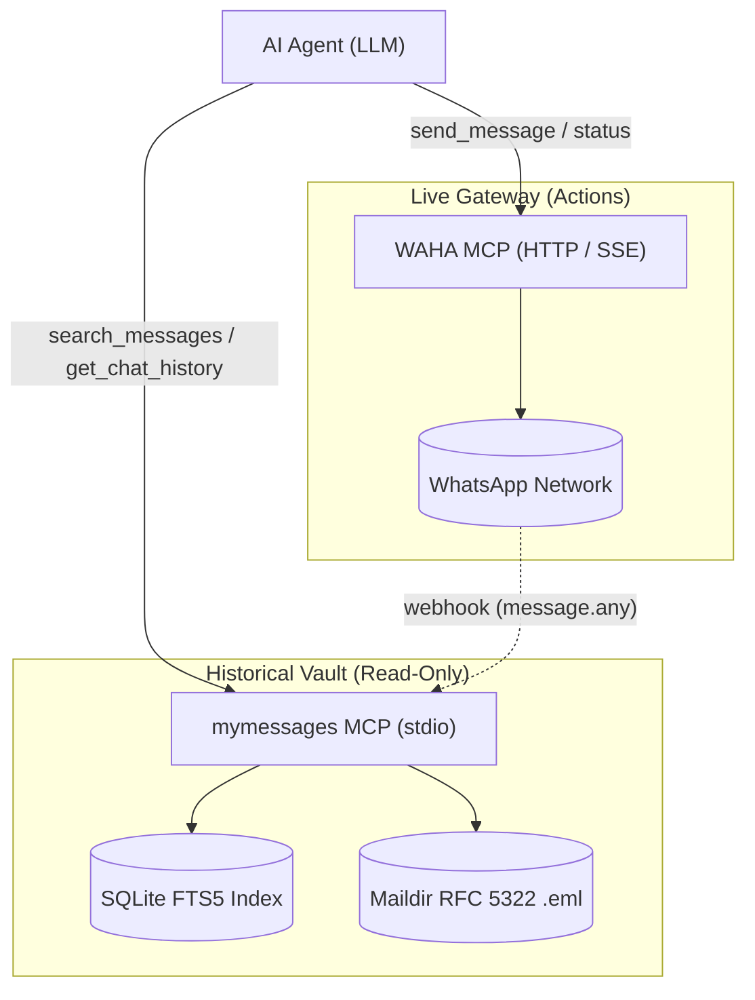

# AI Agents Guide & Protocol (`AGENTS.md`)

This document defines how autonomous AI assistants and LLM agents (Claude Desktop, Claude Code, Cursor, Antigravity, Cline, Goose, OpenClaw) connect to and query `mymessages`.

---

## 1. Architectural Model

`mymessages` enforces a strict separation between **Cold Storage / Historical Retrieval** and **Live Messaging Actions**:



> [!IMPORTANT]
> **`mymessages` is strictly read-only for agents.** It provides immutable message retrieval, full-text search, and Maildir proof-of-record. To dispatch outgoing messages on WhatsApp, agents use companion live gateways like **WAHA**.

---

## 2. Model Context Protocol (MCP) Tools

When launched with `mymessages mcp`, the server exposes 4 search and retrieval tools over standard JSON-RPC 2.0 `stdio`:

### `search_messages`
Full-text search using SQLite FTS5 with BM25 relevance scoring and highlighted snippets.
* **Arguments**:
  * `query` *(string, required)*: Keywords or search phrases (e.g. `"invoice"`, `"contract"`, `"flight"`).
  * `source` *(string, optional)*: Filter by source protocol (e.g. `"whatsapp"`).
  * `chat_id` *(string, optional)*: Restrict search to a specific conversation ID.
  * `has_media` *(boolean, optional)*: Filter messages that contain media attachments.
  * `media_type` *(string, optional)*: Filter by media type (`"image"`, `"audio"`, `"document"`, `"video"`).
  * `is_from_me` *(boolean, optional)*: `true` for outgoing, `false` for incoming.
  * `limit` *(integer, optional)*: Maximum messages (default: 20, max: 100).

### `list_chats`
List known conversations and group chats with metadata.
* **Arguments**:
  * `source` *(string, optional)*: Filter by source identifier (e.g. `"whatsapp"`).
* **Returns**: Array of conversations with `id`, `name`, `remote_id`, `is_group`, `message_count`, and `last_message`.

### `get_chat_history`
Retrieve chronological message timeline for a given conversation.
* **Arguments**:
  * `chat_id` *(string, required)*: The conversation ID or remote JID.
  * `limit` *(integer, optional)*: Maximum messages to retrieve (default: 30).
  * `before` *(integer, optional)*: Timestamp cursor for backward pagination.

### `get_attachment_info`
Retrieve detailed metadata and local file location for an attachment.
* **Arguments**:
  * `attachment_id` *(string, required)*: Unique attachment identifier.
* **Returns**: MIME type, file size, SHA-256 hash, and local Maildir `.eml` relative path.

---

## 3. Recommended Agent Workflow

When assisting a user with message history:

1. **Locate Target Chat**:
   If the user specifies a person or group name, call `list_chats` to find the corresponding `chat_id`.
2. **Execute Targeted Search**:
   Call `search_messages` with specific keywords and facet filters (e.g. `media_type: "document"`).
3. **Inspect Surrounding Context**:
   Use `get_chat_history` with the `chat_id` to read messages directly preceding and following the match for context.
4. **Cite Faithfully**:
   Always report the sender name, timestamp, and message body accurately.

---

## 4. MCP Agent Configurations

### Claude Desktop (`~/.config/Claude/claude_desktop_config.json`)
```json
{
  "mcpServers": {
    "mymessages": {
      "command": "mymessages",
      "args": ["mcp", "--config", "/absolute/path/to/mymessages.toml"]
    },
    "waha": {
      "command": "npx",
      "args": [
        "-y",
        "mcp-remote",
        "http://localhost:8768/mcp",
        "--header",
        "X-Api-Key:waha-secret-key"
      ]
    }
  }
}
```

### Claude Code CLI
```bash
claude mcp add --transport stdio mymessages -- mymessages mcp
```
