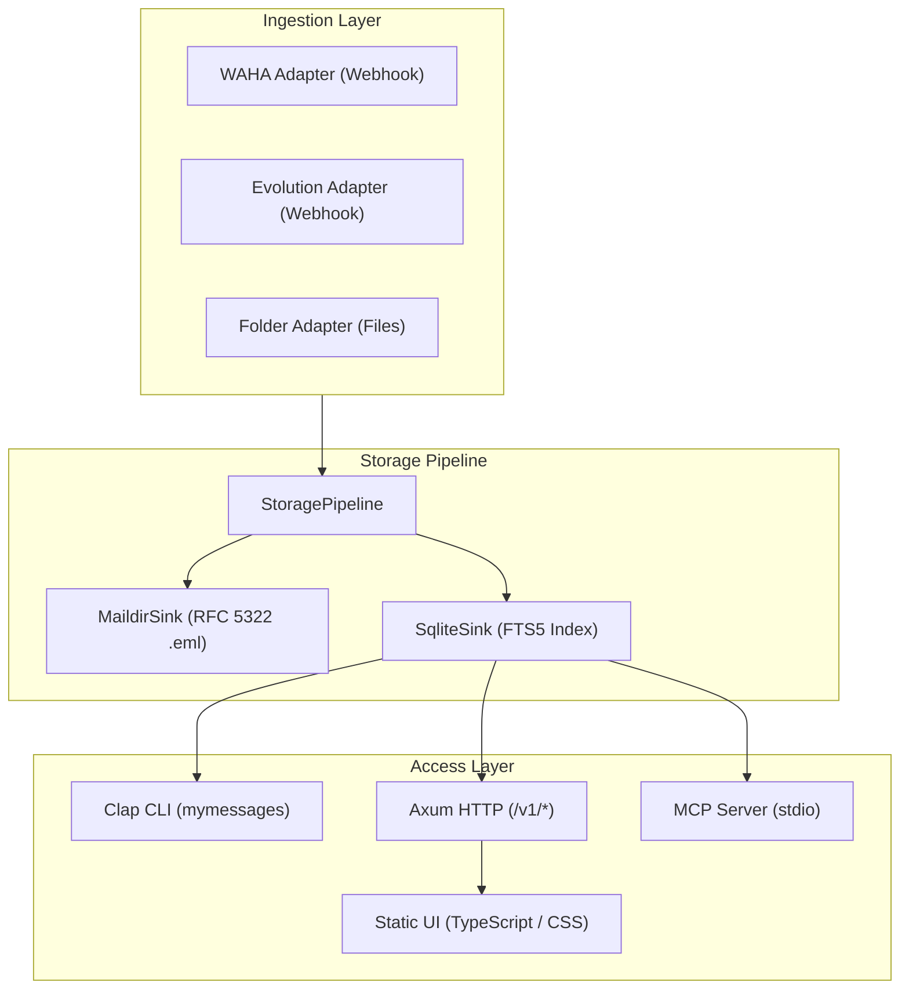

# AI Developer & Coding Guide (`AGENTS.md`)

This guide defines the engineering standards, architecture, and quality gates for autonomous AI agents (Antigravity, Claude Code, Cursor, Cline, Copilot, Goose) developing and modifying the `mymessages` codebase.

---

## 1. Core Architecture & Philosophy

`mymessages` is a local-first personal messaging vault, Maildir RFC 5322 archiver, and SQLite FTS5 full-text search engine with an embedded Axum HTTP API, static TypeScript frontend, and native MCP server.



### Key Principles
1. **Maildir is the Source of Truth**: Incoming messages and attachments are saved as standard RFC 5322 `.eml` files. If the SQLite database is lost, the entire vault can be reconstructed via `mymessages reindex --from maildir --to db`.
2. **Vault is Strictly for Querying Stored Messages**: `mymessages` queries only already stored and indexed messages. It NEVER dispatches live outgoing messages, nor does it access adapters (WAHA, Evolution, etc.) during queries. If users or agents need to access adapters or dispatch messages, they interact with the adapter directly.
3. **Dual Agent Integration**: Users can choose how AI assistants query `mymessages`:
   - **MCP Server** (`mymessages mcp` over `stdio`) — documented in [docs/MCP.md](docs/MCP.md).
   - **CLI / HTTP Skill** (`mymessages search` or `/v1/*`) — documented in [skills/mymessages/SKILL.md](skills/mymessages/SKILL.md).

---

## 2. Non-Negotiable Rules for AI Agents

All AI agents writing code in this repository MUST strictly follow these rules:

### Rule 1: Always Use `mise` for Tasks
Never invoke raw tool commands when a task exists in [.mise.toml](.mise.toml). Always use `mise run <task>`:
```bash
mise run test        # Run all unit tests (Rust + Web)
mise run coverage    # Enforce >= 80% coverage on Rust & Web
mise run e2e         # Run end-to-end integration tests
mise run build       # Build web assets and release binary
mise run screenshot  # Capture dark and light WebUI screenshots
mise run gif         # Generate animated GIF of real-time search
mise run dev         # Run development backend server
mise run web:dev     # Run frontend Vite dev server
```

### Rule 2: Minimum 80% Test Coverage Gate
- **Threshold**: All code additions must maintain **>= 80% line coverage** for both Rust and the Web frontend.
- **Verification**: Always execute `mise run coverage` before committing.
- **Coverage Commands**:
  - Rust: `cargo llvm-cov --fail-under-lines 80`
  - Web: `npm --prefix web run test:coverage` (vitest v8 reporter)
- Both unit tests and end-to-end (`tests/e2e_*.rs`) tests are required.

### Rule 3: Keep Files Short and Modular
- **Strict Limit**: Keep all files short (**< 150–200 lines**).
- Avoid monolithic files or catch-all modules.
- Split large structures into dedicated files (e.g. separate protocol, tools, and server in `src/mcp/`; separate routes, handlers, and state in `src/api/`).

### Rule 4: No Hardcoded Constants & High Configurability
- Never hardcode ports, URLs, paths, or storage flags in logic.
- Everything must be configurable via [mymessages.toml](mymessages.toml) or CLI arguments.
- Default port is **`8765`** (never common defaults like `8080`, `3000`, or `8000`).

### Rule 5: API Route Versioning (`/v1/`)
- All new REST endpoints must reside under `/v1/` (e.g. `/v1/search`, `/v1/chats`, `/v1/webhook/waha`).
- Backward compatibility aliases under `/api/v1/` must be maintained for existing integrations.
- Document all routes with `utoipa` annotations for OpenAPI 3.1 generation.

### Rule 6: Non-Root Execution & Security
- Never run production containers or daemons as `root`.
- The [Dockerfile](Dockerfile) uses Alpine 3.21 with non-root user `appuser:appgroup` (UID/GID `10001`).

### Rule 7: MCP Stdio Hygiene
- When `mymessages mcp` is running, standard output (`stdout`) is strictly reserved for JSON-RPC 2.0 messages.
- All tracing, logging, and error output MUST write to standard error (`stderr`):
  ```rust
  tracing_subscriber::fmt().with_writer(std::io::stderr).init();
  ```

### Rule 8: Git & Commit Standards
- Follow Conventional Commits: `feat:`, `fix:`, `docs:`, `test:`, `refactor:`, `chore:`.
- In all user communications and PR descriptions, use clickable `file://` Markdown links for file references.

### Rule 9: Web UI Automation & Complete Release Checklist
- **Preserve Automation Contracts**: The Web UI (React + TanStack Router + TanStack Query + Tailwind CSS v4) must preserve URL query hydration (`?q=...&account=...&source=...&media_type=...&has_media=...`), multiline wrapping on `.search-facets-bar`, and `data-testid` / `data-facet-group` / `data-facet-value` attributes relied on by `scripts/capture_screenshot.mjs` and `scripts/generate_demo_gif.mjs`.
- **Full Release Procedure**: Whenever cutting a release, follow every step in [docs/RELEASING.md](docs/RELEASING.md):
  1. Bump version in `Cargo.toml`, `Cargo.lock`, `web/package.json`, `src/api/openapi.rs`, and `README.md`.
  2. Run `mise run test` and `mise run coverage` (>= 80% Rust & Web).
  3. Regenerate UI assets via `mise run screenshot` and `mise run gif`, and verify the GIF reflects live filtering.
  4. Run `mise run build`, commit all changes, create annotated tag `vX.Y.Z`, and push `git push origin master --tags`.

---

## 3. Directory Layout

```
.
├── .github/workflows/   # CI (coverage & test) and Release (GHCR container)
├── .mise.toml           # Mise task runner definitions
├── AGENTS.md            # This engineering rules guide
├── Cargo.toml           # Rust package configuration
├── Dockerfile           # Alpine 3.21 non-root production container
├── docs/                # Architecture, MCP, Adapters, Release guides
│   ├── ADAPTERS.md      # Ingestion adapters specification
│   ├── MCP.md           # Model Context Protocol configuration
│   ├── RELEASING.md     # SemVer release checklist
│   └── ROADMAP.md       # Project phases & roadmap
├── mymessages.toml      # Default runtime configuration
├── skills/              # Agent skills for CLI / HTTP interaction
│   └── mymessages/      # Query skill via CLI & HTTP API (/v1/*)
├── src/                 # Rust backend source
│   ├── adapters/        # Source ingestion adapters (Evolution, WAHA, Folder)
│   ├── api/             # Axum HTTP routes, OpenAPI, and Swagger UI
│   ├── cli/             # Clap CLI subcommands
│   ├── config/          # TOML configuration parser
│   ├── index/           # SQLite FTS5 index, metadata extractor, Lucene/Elastic DSL, reindex
│   ├── mcp/             # Native MCP server & read-only tools
│   ├── models/          # Canonical domain entities
│   ├── storage/         # RFC 5322 Maildir, EML serializer, storage sinks
│   ├── lib.rs           # Core library entrypoint
│   └── main.rs          # CLI executable entrypoint
├── tests/               # E2E integration tests & sample messages
└── web/                 # Static TypeScript frontend (Vite + Vitest)
```

---

## 4. Testing & Verification Checklist

Before creating a commit or opening a pull request, run:

1. `mise run secrets` — Ensure zero leaked credentials or secrets (`gitleaks`).
2. `mise run test` — Ensure all unit tests (and secret scan) pass.
3. `mise run e2e` — Ensure end-to-end sync, search, and static file tests pass.
4. `mise run coverage` — Confirm line coverage is `>= 80%` on both Rust and Web.
5. `mise run build` — Verify production web bundle and Rust release binary compile without warnings.
