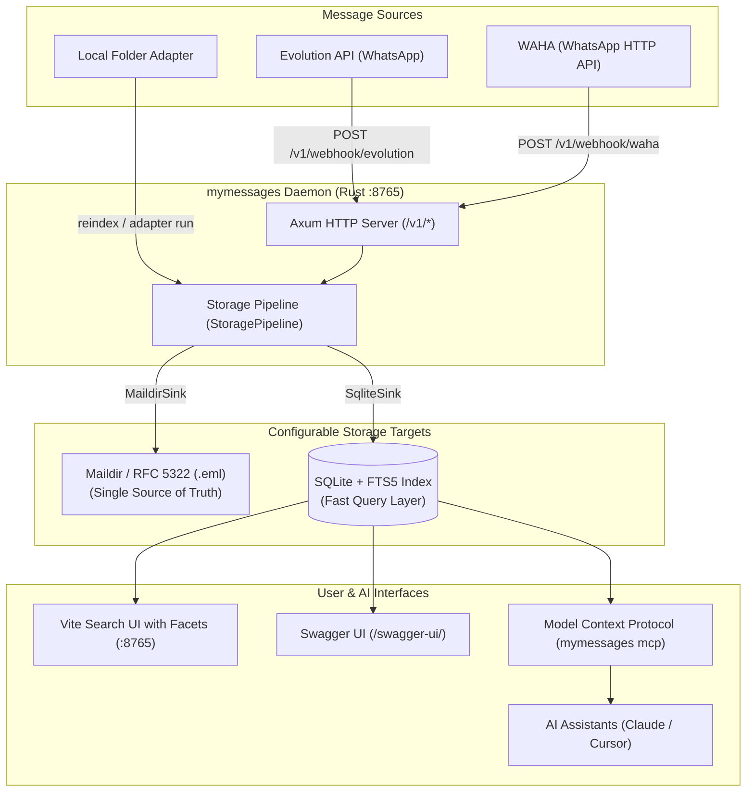

# mymessages

[](https://github.com/rodvieirasilva/mymessages/actions/workflows/ci.yml)
[](https://github.com/rodvieirasilva/mymessages/releases)
[](https://www.rust-lang.org/)
[](LICENSE)

A local-first, source-agnostic personal messaging vault, archiver, and search engine written in Rust.

`mymessages` preserves your chat history and media across communication platforms by archiving every message into an open, future-proof **Maildir / RFC 5322 (`.eml`)** directory structure with full MIME attachments, paired with an ultra-fast, searchable **SQLite FTS5** index, an interactive web search interface with facets, and a native **Model Context Protocol (MCP)** server for AI assistants.

---

## Key Highlights

- **Source Agnostic**: Core vault engine is completely decoupled from any single messaging platform.
- **WhatsApp Ingestion (WAHA & Evolution API)**: Ingests live WhatsApp messages, attachments, audio voice notes, and documents in real time from companion containers.
- **Maildir / RFC 5322 Single Source of Truth**: Standard EML files with multipart MIME attachments. Readable by standard email clients decades from now.
- **Fast Full-Text Search (SQLite FTS5)**: BM25 relevance ranking, highlighted match snippets, and instant queries across text and attachments.
- **Cryptographic Deduplication**: Deterministic SHA-256 content hashing guarantees no duplicate messages or files are ever stored twice.
- **Super-Indexed Metadata & Elasticsearch JSON Query DSL**: Automatically extracts and indexes arbitrary metadata key-values into SQLite `message_metadata` and FTS5. Supports complex Lucene string queries (`from:`, `after:`, `before:`, `type:`, `meta.*:`) and the safe IETF HTTP **`QUERY`** / **`POST`** methods with Elasticsearch JSON Query DSL bodies (`bool`, `must`, `filter`, `range`).
- **Search Web UI with Dynamic Facets**: Lightweight, responsive Vite + TypeScript frontend with instant filtering by Source, Media Type (Images, Audio, Docs, Videos), and Direction.
- **Native Model Context Protocol (MCP)**: Built-in `mymessages mcp` server over `stdio` allowing AI assistants (Claude Desktop, Cursor, Antigravity) to search and retrieve historical context.
- **Versioned API & Swagger UI**: OpenAPI 3.1 schema and interactive Swagger UI served out-of-the-box at `http://localhost:8765/swagger-ui/` with `/v1/` versioned routes.
- **Zero-Loss Rebuilding**: The SQLite database can be erased and completely re-indexed from the Maildir archive at any moment.
- **Ultra-Minimal Alpine Docker**: Hardened multi-stage container image (~15MB) running as a dedicated non-root user (`10001:10001`).

---

## Architecture Overview



---

## Quickstart

### 1. Run with Docker Compose
The fastest way to spin up `mymessages` alongside WhatsApp companion services:

```bash
docker compose up -d
```

Services exposed:
- **`mymessages` Web Search & Vault**: [http://localhost:8765](http://localhost:8765)
- **Interactive Swagger UI**: [http://localhost:8765/swagger-ui/](http://localhost:8765/swagger-ui/)
- **OpenAPI 3.1 Spec**: [http://localhost:8765/api-docs/openapi.json](http://localhost:8765/api-docs/openapi.json)
- **Evolution API**: `http://localhost:8766`
- **Evolution Manager Web Dashboard**: `http://localhost:8767`

### 2. Run Locally with `mise`
Ensure [mise](https://mise.jdx.dev/) is installed:

```bash
# Run unit & integration tests
mise run test

# Check test coverage (>= 80% line coverage enforced)
mise run coverage

# Start background server
mise run dev
```

---

## Configuration (`mymessages.toml`)

All ports, paths, adapters, and storages are fully configurable:

```toml
[server]
host = "0.0.0.0"
port = 8765
static_dir = "./web/dist"
cors_allowed_origins = ["*"]

[[storages]]
name = "maildir"
type = "maildir"
enabled = true
path = "./data/mail"

[[storages]]
name = "sqlite"
type = "sqlite"
enabled = true
path = "./data/messages.sqlite3"

[adapters.evolution]
enabled = true
webhook_path = "/v1/webhook/evolution"

[adapters.waha]
enabled = true
webhook_path = "/v1/webhook/waha"
api_url = "http://127.0.0.1:8768"

[adapters.folder]
enabled = true
folder_path = "./tests/test_messages"
file_pattern = "*.json"
```

---

## AI Agent Integration (MCP or Skill)

AI assistants and LLM agents can connect to `mymessages` using either **Model Context Protocol (MCP)** or an **Agent Skill (CLI & HTTP)**:

### Option 1: Native Read-Only MCP Server (`stdio`)
For environments supporting MCP (Claude Desktop, Claude Code, Cursor, Goose, Antigravity):
```bash
mymessages mcp
```
See [docs/MCP.md](docs/MCP.md) for tool signatures (`search_messages`, `list_chats`, `get_chat_history`, `get_attachment_info`) and client setup.

### Option 2: Query Skill (CLI & HTTP REST)
For agents operating via terminal commands or REST HTTP calls:
- CLI search: `mymessages search "invoice"`
- HTTP REST API: `GET /v1/search?query=invoice`, `GET /v1/chats`
- See [skills/mymessages/SKILL.md](skills/mymessages/SKILL.md) for workflows, query options, and curl examples.

> [!NOTE]
> `mymessages` is strictly for querying already stored messages. Neither the MCP server nor the Skill interacts with live adapters or sends live messages. If adapter interaction is needed, connect to that adapter directly.

---

## Documentation

- [AI Developer & Coding Rules (`AGENTS.md`)](AGENTS.md)
- [System Architecture](docs/ARCHITECTURE.md)
- [Model Context Protocol Guide](docs/MCP.md)
- [Query Skill (CLI / HTTP)](skills/mymessages/SKILL.md)
- [Ingestion Adapters Guide](docs/ADAPTERS.md)
- [Release Process](docs/RELEASING.md)
- [Implementation Roadmap](docs/ROADMAP.md)

---

## License

Dual-licensed under either Apache 2.0 or MIT at your option.
