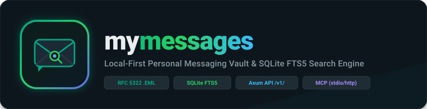
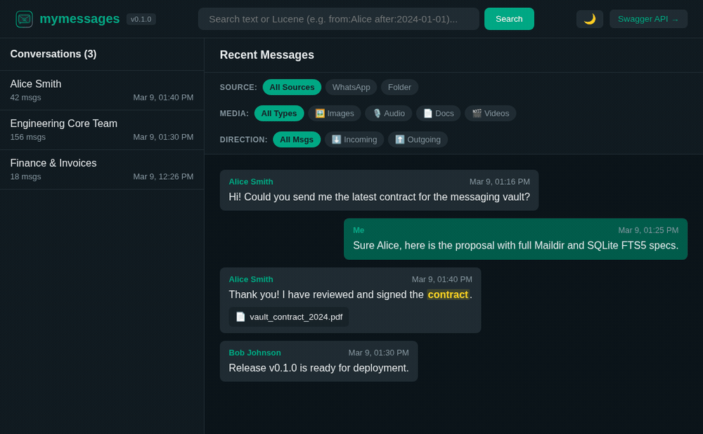

<p align="center">
  
</p>

# mymessages

[](https://github.com/rodvieirasilva/mymessages/actions/workflows/ci.yml)
[](https://github.com/rodvieirasilva/mymessages/releases)
[](https://www.rust-lang.org/)
[](LICENSE)

A local-first, source-agnostic personal messaging vault, archiver, and search engine written in Rust.

`mymessages` preserves your chat history and media across communication platforms by archiving every message into an open, future-proof **Maildir / RFC 5322 (`.eml`)** directory structure with full MIME attachments, paired with an ultra-fast, searchable **SQLite FTS5** index, an interactive web search interface with facets, and a native **Model Context Protocol (MCP)** server for AI assistants.

---

## Key Highlights

- **Source Agnostic**: Core vault engine is completely decoupled from any single messaging platform.
- **WhatsApp Ingestion (WAHA, Evolution API & UBack)**: Ingests live WhatsApp messages from companion containers as well as [UBack](https://github.com/rodvieirasilva/uback) Android media & `.crypt15` backup folders with **zero media duplication** (using `WHATSAPP_64DIGI_<account>` decryption keys from env vars or credentials files).
- **Multi-Account Cross-Search**: Index multiple devices/accounts side-by-side, search across all accounts simultaneously, or filter by account via the Web UI **Account** facet, Lucene `account:<name>`, HTTP API (`/v1/accounts`, `/v1/search?account=...`), CLI (`--account`), or MCP.
- **Maildir / RFC 5322 Single Source of Truth**: Standard EML files with multipart MIME attachments (or zero-duplication external attachment references). Readable by standard email clients decades from now.
- **Fast Full-Text Search (SQLite FTS5)**: BM25 relevance ranking, highlighted match snippets, and instant queries across text and attachments.
- **Cryptographic Deduplication**: Deterministic SHA-256 content hashing guarantees no duplicate messages or files are ever stored twice.
- **Super-Indexed Metadata & Elasticsearch JSON Query DSL**: Automatically extracts and indexes arbitrary metadata key-values into SQLite `message_metadata` and FTS5. Supports complex Lucene string queries (`from:`, `account:`, `after:`, `before:`, `type:`, `meta.*:`) and the safe IETF HTTP **`QUERY`** / **`POST`** methods with Elasticsearch JSON Query DSL bodies (`bool`, `must`, `filter`, `range`).
- **Search Web UI with Dynamic Facets**: Lightweight, responsive Vite + TypeScript frontend with instant filtering by Account, Source, Media Type (Images, Audio, Docs, Videos), and Direction.
- **Native Model Context Protocol (MCP)**: Built-in `mymessages mcp` server over `stdio` allowing AI assistants (Claude Desktop, Cursor, Antigravity) to search and retrieve historical context.
- **Versioned API & Swagger UI**: OpenAPI 3.1 schema and interactive Swagger UI served out-of-the-box at `http://localhost:8765/swagger-ui/` with `/v1/` versioned routes.
- **Zero-Loss Rebuilding**: The SQLite database can be erased and completely re-indexed from the Maildir archive at any moment.
- **Ultra-Minimal Alpine Docker**: Hardened multi-stage container image (~15MB) running as a dedicated non-root user (`10001:10001`).

---

## Architecture Overview

```mermaid
flowchart TD
    subgraph Sources["Message Sources"]
        UBACK["UBack (Historical Media + Deltas / .crypt15)"]
        WA_EVO["Evolution API (Real-Time WhatsApp)"]
        WA_WAHA["WAHA (Real-Time WhatsApp HTTP API)"]
        LOCAL_DIR["Local Folder Adapter"]
    end

    subgraph Daemon["mymessages Daemon (Rust :8765)"]
        ROUTER["Axum HTTP Server (/v1/*)"]
        PIPELINE["Storage Pipeline (StoragePipeline)"]
    end

    subgraph Storage["Configurable Storage Targets"]
        MAILDIR["Maildir / RFC 5322 (.eml)
(Single Source of Truth)"]
        SQLITE[("SQLite + FTS5 Index
(Fast Query Layer)")]
    end

    subgraph Consumers["User & AI Interfaces"]
        WEB["Vite Search UI with Facets (:8765)"]
        SWAGGER["Swagger UI (/swagger-ui/)"]
        MCP["Model Context Protocol (mymessages mcp)"]
        AI["AI Assistants (Claude / Cursor / Antigravity)"]
    end

    UBACK -->|adapter run uback (zero media dup)| PIPELINE
    WA_EVO -->|POST /v1/webhook/evolution| ROUTER
    WA_WAHA -->|POST /v1/webhook/waha| ROUTER
    LOCAL_DIR -->|reindex / adapter run| PIPELINE

    ROUTER --> PIPELINE
    PIPELINE -->|MaildirSink| MAILDIR
    PIPELINE -->|SqliteSink| SQLITE

    SQLITE --> WEB
    SQLITE --> SWAGGER
    SQLITE --> MCP
    MCP --> AI
```

---

## Choosing Your WhatsApp Ingestion Strategy

`mymessages` supports two complementary WhatsApp ingestion paths — and you can use **both together** with automatic SHA-256 deduplication:

| Method | Best For | Why Use It |
| :--- | :--- | :--- |
| **[UBack](https://github.com/rodvieirasilva/uback) *(Recommended for Historical Backups)*** | Years of existing WhatsApp & WhatsApp Business history across multiple phones/accounts | Backs up your full historical chat archive via incremental SQLite deltas (`deltas/`) or encrypted `.crypt15` databases (`databases/`) plus media (`received/` & `sent/`) with **zero media duplication** — `mymessages` streams media directly from your UBack backup folder. |
| **WAHA / Evolution API *(Real-Time Webhooks)*** | Live, continuous capture of incoming & outgoing messages | Captures every message in real time and automatically downloads **full attachments immediately — even if you never download them on your phone** (and even if a sender later deletes them). |

### Syncing Multi-Account UBack Backups
Provide each account's 64-digit WhatsApp encryption key via environment variable (`WHATSAPP_64DIGI_<account>`) or a local gitignored credentials file (`~/.credentials` or `MYMESSAGES_CREDENTIALS_FILE`):

```bash
# Auto-discover all device/account folders under your UBack backup root (zero media duplication)
mymessages adapter run uback --path /path/to/uback/phone-backups

# Search across all accounts, or narrow to one account
mymessages search "contract"
mymessages search "contract account:personal"
```

---

## Quickstart

### 1. Run with Docker Compose
The fastest way to spin up `mymessages` alongside WhatsApp companion services:

```bash
docker compose up -d
```

Services exposed:
- **`mymessages` Web Search & Vault**: [http://localhost:8765](http://localhost:8765)
- **Interactive Swagger UI**: [http://localhost:8765/swagger-ui/](http://localhost:8765/swagger-ui/)
- **OpenAPI 3.1 Spec**: [http://localhost:8765/api-docs/openapi.json](http://localhost:8765/api-docs/openapi.json)
- **Evolution API**: `http://localhost:8766`
- **Evolution Manager Web Dashboard**: `http://localhost:8767`

### 2. Run Locally with `mise`
Ensure [mise](https://mise.jdx.dev/) is installed:

```bash
# Run unit & integration tests
mise run test

# Check test coverage (>= 80% line coverage enforced)
mise run coverage

# Start background server
mise run dev
```

---

## Web Interface & Theme System

`mymessages` includes an embedded, high-performance web interface served at `http://localhost:8765/`:

<p align="center">
  
</p>

<p align="center">
  <em>Real-time search-as-you-type, Lucene field filters, facet pills, and instant dark/light theme switching.</em>
</p>

### Mini Color & Theme Token System
The UI uses CSS custom property tokens for instant theme customization and switching:
- **Dark & Light Modes**: Switch themes live using the 🌙/☀️ button in the header, or via URL query parameter (`?theme=dark` or `?theme=light`).
- **Persistent Preferences**: Stores preference in `localStorage` and automatically defaults to your OS preference (`prefers-color-scheme`).
- **Design Tokens**: Defined in `web/src/styles/tokens.css` under `[data-theme="dark"]` and `[data-theme="light"]`:
  - `--bg-primary`, `--bg-secondary`, `--bg-card`: Surface levels.
  - `--bg-outgoing`: Chat bubble background for sent messages (`#005c4b` in dark, `#d9fdd3` in light).
  - `--accent`: Emerald branding accent (`#00a884` in dark, `#008069` in light).
  - `--text-primary`, `--text-secondary`: High and medium contrast text.
  - `--border`, `--border-active`: Crisp layout dividers.

### Updating WebUI Screenshots & Demo GIF
To re-render and capture updated screenshots or the animated demo GIF:
```bash
# Capture dark and light PNG screenshots
mise run screenshot

# Generate optimized animated demo GIF
mise run gif
```
Static screenshots are saved to `docs/assets/screenshot-dark.png` and `docs/assets/screenshot-light.png`, and the animated preview to `docs/assets/realtime-filter.gif`.

---

## Configuration (`mymessages.toml`)

All ports, paths, adapters, and storages are fully configurable (with environment variable overrides such as `MYMESSAGES_HOST`, `MYMESSAGES_PORT`, `MYMESSAGES_DATA_DIR`, `MYMESSAGES_UBACK_ROOT`, `MYMESSAGES_CREDENTIALS_FILE`, and `WHATSAPP_64DIGI_<account>`):

```toml
[server]
host = "127.0.0.1"
port = 8765
static_dir = "./web/dist"
cors_allowed_origins = ["http://localhost:8765", "http://127.0.0.1:8765"]

[[storages]]
name = "maildir"
type = "maildir"
enabled = true
path = "./data/mail"

[[storages]]
name = "sqlite"
type = "sqlite"
enabled = true
# Supports plain paths or SQLite URI connection strings (e.g. "sqlite:///data/messages.sqlite3?journal_mode=DELETE" or "file:...?journal_mode=WAL")
path = "./data/messages.sqlite3"

[adapters.evolution]
enabled = true
webhook_path = "/v1/webhook/evolution"

[adapters.waha]
enabled = true
webhook_path = "/v1/webhook/waha"
api_url = "http://127.0.0.1:8768"

[adapters.folder]
enabled = true
folder_path = "./tests/test_messages"
file_pattern = "*.json"

# UBack Android Backup Adapter (zero-duplication media + deltas / .crypt15)
# Keys are loaded automatically from env vars `WHATSAPP_64DIGI_<account>` or `credentials_file`
[adapters.uback]
enabled = false
backup_root = ""
# credentials_file = "~/.credentials"
accounts = []
index_media_without_db = false
```

---

## AI Agent Integration (MCP or Skill)

AI assistants and LLM agents can connect to `mymessages` using either **Model Context Protocol (MCP)** or an **Agent Skill (CLI & HTTP)**:

### Option 1: Native Read-Only MCP Server (`stdio` & `http`)
For environments supporting MCP (Claude Desktop, Claude Code, Cursor, Antigravity / `agy`, Goose):
```bash
# stdio mode (local subprocess)
mymessages mcp

# http mode (service on port 8765)
mymessages serve
```
See [docs/MCP.md](docs/MCP.md) for tool signatures, `stdio` configs, and `http` endpoint setup.

### Option 2: Query Skill (CLI & HTTP REST)
For agents operating via terminal commands or REST HTTP calls:
- CLI search: `mymessages search "invoice"`
- HTTP REST API: `GET /v1/search?query=invoice`, `GET /v1/chats`, `GET /v1/fields`, `GET /v1/stats`
- See [skills/mymessages/SKILL.md](skills/mymessages/SKILL.md) for workflows, query options, and curl examples.

> [!NOTE]
> `mymessages` is strictly for querying already stored messages. Neither the MCP server nor the Skill interacts with live adapters or sends live messages. If adapter interaction is needed, connect to that adapter directly.

---

## Documentation

- [AI Developer & Coding Rules (`AGENTS.md`)](AGENTS.md)
- [System Architecture](docs/ARCHITECTURE.md)
- [Model Context Protocol Guide](docs/MCP.md)
- [Query Skill (CLI / HTTP)](skills/mymessages/SKILL.md)
- [Ingestion Adapters Guide](docs/ADAPTERS.md)
- [Release Process](docs/RELEASING.md)

---

## License

Dual-licensed under either Apache 2.0 or MIT at your option.
