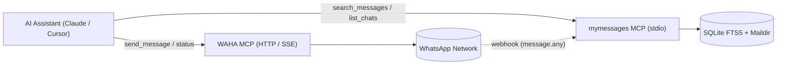

# Model Context Protocol (MCP) Guide

`mymessages` includes a native Model Context Protocol (MCP) server operating over `stdio`, allowing local AI assistants (such as Claude Desktop, Claude Code, Cursor, Goose, and Antigravity) to search and retrieve archived messages.

---

## 1. `mymessages` MCP Server

### Principle of Operation
- Runs as a standard subprocess via `mymessages mcp`.
- Communicates via JSON-RPC 2.0 over standard input and output (`stdio`).
- **Strictly read-only**: Exposes search and retrieval tools only.

### Available Tools

#### `search_messages`
Full-text search using SQLite FTS5 with BM25 relevance scoring and highlighted snippets.
* **Arguments**:
  * `query` *(string, required)*: Keywords or search phrases (e.g. `"invoice"`, `"contract"`, `"flight"`).
  * `source` *(string, optional)*: Filter by source protocol (e.g. `"whatsapp"`).
  * `chat_id` *(string, optional)*: Restrict search to a specific conversation ID.
  * `has_media` *(boolean, optional)*: Filter messages that contain media attachments.
  * `media_type` *(string, optional)*: Filter by media type (`"image"`, `"audio"`, `"document"`, `"video"`).
  * `is_from_me` *(boolean, optional)*: `true` for outgoing, `false` for incoming.
  * `limit` *(integer, optional)*: Maximum messages (default: 20, max: 100).

#### `list_chats`
List known conversations and group chats with metadata.
* **Arguments**:
  * `source` *(string, optional)*: Filter by source identifier (e.g. `"whatsapp"`).
* **Returns**: Array of conversations with `id`, `name`, `remote_id`, `is_group`, `message_count`, and `last_message`.

#### `get_chat_history`
Retrieve chronological message timeline for a given conversation.
* **Arguments**:
  * `chat_id` *(string, required)*: The conversation ID or remote JID.
  * `limit` *(integer, optional)*: Maximum messages to retrieve (default: 30).
  * `before` *(integer, optional)*: Timestamp cursor for backward pagination.

#### `get_attachment_info`
Retrieve detailed metadata and local file location for an attachment.
* **Arguments**:
  * `attachment_id` *(string, required)*: Unique attachment identifier.
* **Returns**: MIME type, file size, SHA-256 hash, and local Maildir `.eml` relative path.

---

## 2. Pairing with WAHA MCP (Active WhatsApp Gateway)

While `mymessages` handles indexing, search, and cold-storage retrieval, **WAHA (WhatsApp HTTP API)** provides live connection and message dispatch capabilities.



---

## 3. Configuration Example

### Claude Desktop / Cursor (`~/.config/Claude/claude_desktop_config.json`)

```json
{
  "mcpServers": {
    "mymessages": {
      "command": "mymessages",
      "args": ["mcp", "--config", "./mymessages.toml"]
    },
    "waha": {
      "command": "npx",
      "args": [
        "-y",
        "mcp-remote",
        "http://localhost:8768/mcp",
        "--header",
        "X-Api-Key:waha-secret-key"
      ]
    }
  }
}
```

### Claude Code CLI

```bash
claude mcp add --transport stdio mymessages -- mymessages mcp
claude mcp add --transport http waha http://localhost:8768/mcp --header "X-Api-Key: waha-secret-key"
```
