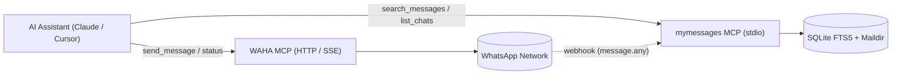

# Model Context Protocol (MCP) Guide

`mymessages` includes a native Model Context Protocol (MCP) server operating over `stdio`, allowing local AI assistants (such as Claude Desktop, Claude Code, Cursor, Goose, and Antigravity) to search and retrieve archived messages.

---

## 1. `mymessages` MCP Server

### Principle of Operation
- Runs as a standard subprocess via `mymessages mcp`.
- Communicates via JSON-RPC 2.0 over standard input and output (`stdio`).
- **Strictly read-only**: Exposes search and retrieval tools only.

### Available Tools
1. **`search_messages`**: FTS5 full-text query with keyword, chat, source, and media filters.
2. **`list_chats`**: List conversation summaries with message counts and timestamps.
3. **`get_chat_history`**: Retrieve chronological messages for a conversation ID.
4. **`get_attachment_info`**: Retrieve metadata and local Maildir path for media files.

---

## 2. Pairing with WAHA MCP (Active WhatsApp Gateway)

While `mymessages` handles indexing, search, and cold-storage retrieval, **WAHA (WhatsApp HTTP API)** provides live connection and message dispatch capabilities.



---

## 3. Configuration Example

Add to `claude_desktop_config.json`:

```json
{
  "mcpServers": {
    "mymessages": {
      "command": "mymessages",
      "args": ["mcp", "--config", "./mymessages.toml"]
    },
    "waha": {
      "command": "npx",
      "args": [
        "-y",
        "mcp-remote",
        "http://localhost:8768/mcp",
        "--header",
        "X-Api-Key:waha-secret-key"
      ]
    }
  }
}
```
