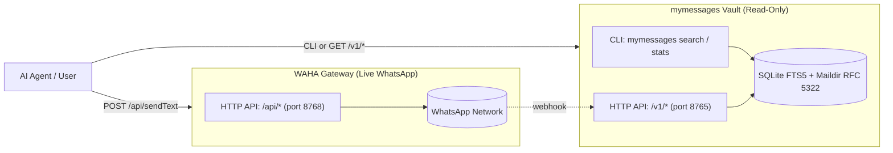

# WhatsApp Vault & Messaging Skill (CLI & HTTP)

Use this skill when you need to search past WhatsApp/messaging history, retrieve message timelines, or find attachments using the **CLI** or **HTTP API**, and optionally dispatch outgoing messages via **WAHA HTTP API**.

> [!TIP]
> **MCP vs Skill Choice**:
> - If your environment supports Model Context Protocol (MCP), configure the native stdio MCP server as documented in [docs/MCP.md](docs/MCP.md).
> - If you prefer direct CLI commands or HTTP REST calls (e.g. curl, fetch, bash tools), use this **Skill**.

---

## 1. Architectural Model



- **`mymessages`**: Strictly read-only vault for searching history, viewing chat timelines, and inspecting attachments.
- **`WAHA`**: Live gateway for sending messages and checking WhatsApp network status.

---

## 2. Using the CLI (`mymessages`)

When running locally with access to the terminal:

### Search Messages
```bash
# Basic keyword search
mymessages search "contract"

# Search in a specific chat
mymessages search "budget" --chat "1234567890@c.us"

# Filter by source and limit results
mymessages search "invoice" --source whatsapp --limit 10

# Filter for messages containing attachments
mymessages search "proposal" --has-media true
```

### Vault Statistics & Reindexing
```bash
# View current vault statistics
mymessages stats

# Reindex SQLite database from Maildir proof-of-record
mymessages reindex --from maildir --to db

# Ingest test/export messages from a local folder
mymessages adapter run folder --path ./tests/test_messages
```

---

## 3. Using the HTTP API (`/v1`)

When interacting over HTTP REST (default port `8765`):

### 1. Full-Text Search (`GET /v1/search`)
Query parameters:
- `query` *(required)*: Keywords or phrases
- `source`: `"whatsapp"`, `"folder"`
- `chat_id`: Filter by conversation ID
- `has_media`: `true` or `false`
- `media_type`: `"image"`, `"audio"`, `"video"`, `"document"`
- `is_from_me`: `true` (outgoing) or `false` (incoming)
- `limit`: Maximum results (default: 20)

```bash
curl -s "http://localhost:8765/v1/search?query=contract&media_type=document" | jq .
```

### 2. List Conversations (`GET /v1/chats`)
```bash
# List all known conversations
curl -s "http://localhost:8765/v1/chats" | jq .

# Filter by source protocol
curl -s "http://localhost:8765/v1/chats?source=whatsapp" | jq .
```
Response item includes: `id`, `name`, `remote_id`, `is_group`, `message_count`, `last_message`, `last_timestamp`.

### 3. Retrieve Conversation Timeline (`GET /v1/chats/{id}/messages`)
```bash
# Retrieve recent 30 messages in a chat
curl -s "http://localhost:8765/v1/chats/5511988887777@s.whatsapp.net/messages?limit=30" | jq .

# Backward pagination using before timestamp cursor
curl -s "http://localhost:8765/v1/chats/5511988887777@s.whatsapp.net/messages?limit=30&before=1710000000" | jq .
```

### 4. Download / Inspect Attachment (`GET /v1/attachments/{id}`)
```bash
# Stream attachment binary
curl -s "http://localhost:8765/v1/attachments/att_12345" -o downloaded_file.pdf
```

### 5. Interactive API Documentation
- OpenAPI 3.1 Spec: `http://localhost:8765/api-docs/openapi.json`
- Swagger UI Explorer: `http://localhost:8765/swagger-ui/`

---

## 4. Dispatching Live Messages (WAHA HTTP API)

When the user requests to send a message or media on WhatsApp:

### 1. Send Text Message
```bash
curl -X POST "http://localhost:8768/api/sendText" \
  -H "Content-Type: application/json" \
  -H "X-Api-Key: waha-secret-key" \
  -d '{
    "session": "default",
    "chatId": "5511999998888@c.us",
    "text": "Hello, here is the information you requested."
  }'
```

### 2. Send File / Document
```bash
curl -X POST "http://localhost:8768/api/sendFile" \
  -H "Content-Type: application/json" \
  -H "X-Api-Key: waha-secret-key" \
  -d '{
    "session": "default",
    "chatId": "5511999998888@c.us",
    "file": {
      "url": "http://localhost:8765/v1/attachments/att_12345",
      "filename": "contract.pdf"
    },
    "caption": "Here is the contract document."
  }'
```

> [!NOTE]
> All outgoing messages dispatched via WAHA automatically trigger WAHA's webhook to `mymessages` (`/v1/webhook/waha`), ensuring immediate, permanent archival in Maildir and SQLite.

---

## 5. Recommended Agent Workflow

1. **Locate Target Chat**: Call `GET /v1/chats` or search by name.
2. **Execute Targeted Search**: Use CLI `mymessages search "<query>"` or `GET /v1/search?query=...`.
3. **Inspect Context**: Fetch surrounding conversation timeline with `GET /v1/chats/{id}/messages`.
4. **Download or Verify Attachments**: If media is involved, fetch metadata or content via `/v1/attachments/{id}`.
5. **Confirm and Act**: Report findings accurately. If the user asks to respond, dispatch via WAHA HTTP API.
